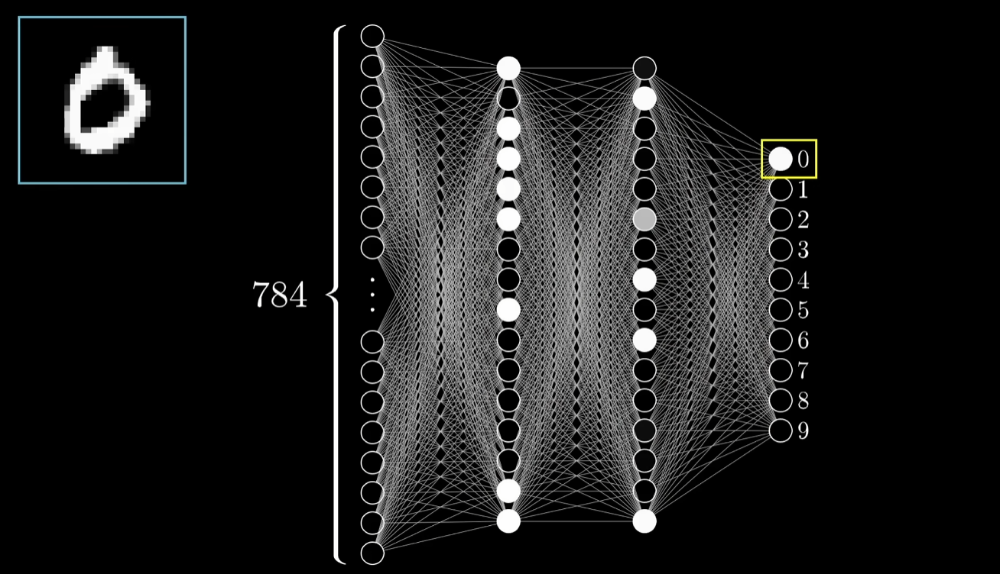
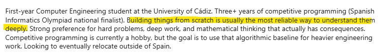

# De dónde vino esto

Me gusta la IA. O al menos, me gusta la idea de lo que significan. Por lo menos había escuchado que tenía muchas mates, y eso está guay. Y encima me gusta la programación competitiva, y la IA está eliminándole como deporte, porque ya Claude Opus 4.7 hace cosas maravillosas, y a mí me da miedo. Entonces, ¿qué papel queda ahí para alguien que ha invertido años entrenando un cerebro para resolver problemas algorítmicos? La respuesta más honesta que se me ocurría era que si las IAs van a dominar lo que llevo entrenando, entonces tengo dos opciones. O me hago mejor que ellas (jaja) o aprendo lo que está debajo de ellas. Lo segundo es más realista, además, ayuda al "resume".

El primer empujón concreto fue el vídeo de 3Blue1Brown sobre redes neuronales. Si no lo has visto, hazte un favor. Es la mejor explicación visual que existe, las activaciones se iluminan al pasar por las capas, los pesos se ven como conexiones que se ajustan, todo tiene una geometría preciosa. Pero ver es una cosa y entender es otra completamente diferente. Cuando intentas reproducir lo que viste, te das cuenta de que el vídeo se salta deliberadamente cosas que no son visuales, porque no podrían serlo. Ahí es cuando nace la matemática que te jode toda la visión del mundo porque es increíble, el álgebra para hacer cosas con matrices, qué significa derivar una función que tiene como entrada una matriz y devuelve un escalar, o sea... Esa parte la tienes que masticar tú solo en una hoja, en una pizarra o en lo que sea. En mi caso fue a las 2 de la mañana.

Antes de meterme con esto había hecho otros proyectos que me gustaron mucho. Un visualizador del [Mandelbrot](https://github.com/linkyless/cpp-playground/tree/main/mandelbrot) en C++ con SFML, un simulador de [Boids](https://github.com/linkyless/cpp-playground/tree/main/boids) también con SFML. Pero esos dos tenían algo en común: eran visuales, gráficos, los veías funcionar y entendías por qué. Si un boid se quedaba quieto, mirabas el código y veías el bug, y era evidente verlo. Las redes neuronales son lo opuesto. La red puede estar funcionando perfectamente o tener un bug que la convierte en pura mediocridad y desde fuera se ven exactamente igual. Eso es chunguillo, pero en resumen quería un proyecto donde no pudiera salir adelante a base de intuición visual y, como mínimo, donde tuviera que apoyarme en matemáticas que demostraran que mi código debería funcionar antes de ejecutarlo, al más puro estilo de Codeforces.

La decisión de hacerlo desde cero, sin frameworks, fue intencional desde el primer día. Si lo haces con PyTorch (que es un framework precisamente para este trabajo) te queda al final una red que funciona pero no sabes muy bien por qué. El conocimiento te lo saltas porque la herramienta te lo regala. Y eso, que nadie piense lo contrario, está bien para producir cosas, pero es pésimo para aprender. Yo lo veo así. De hecho, mi descripción en LinkedIn tiene algo que ver con esto:

Hombre, yo tenía reglas internas. Si numpy ya lo tiene, lo uso (multiplicar matrices, hacer exp). Si es algo de redes neuronales, lo escribo yo. Todo eso de la Sigmoid, softmax, cross-entropy, forward pass, backprop, todo. Si no tienes ni idea de lo que acabo de decir, no pasa nada, que tienes los demás documentos.

Hay algo de honestidad necesaria aquí, por supuesto. Yo no me iba a meter en un proyecto de meses si no tuviera detrás una ansiedad genuina sobre qué voy a hacer con mi vida cuando termine la carrera. Esto no es solo "qué guay aprender redes neuronales", aunque también lo sea. Es también un intento de cubrirme las espaldas. Todos los caminos que me parecen interesantes pasan por, mínimo, entender esto bien. Y entender esto bien no se consigue con un curso de tres horas en YouTube.

## Lo que tenía claro al empezar

Sabía que no quería usar frameworks de ML. Sabía que quería entender backpropagation a nivel de poder explicarlo en una pizarra sin notas. Sabía que tenía que terminar con algo que pudiera enseñar, una demo donde alguien pudiera dibujar un número con el ratón y ver a la red predecir, porque sin eso el proyecto se quedaría en una carpeta de mi disco duro (que por cierto, está en sus últimas ya). Y sabía, intuía al menos, que iba a sufrir. 
Por supuesto, sabía que no iba a usar prácticamente IA, solo las cosas más básicas o por si me quedaba estancado en algún momento muy concreto. Digamos, entonces, que el 90% del trabajo tendría que ser mío y el 100% del pensamiento inicial también.

## Lo que no tenía ni idea

No tenía ni idea de cuánto iba a sufrir. Backpropagation me destrozó durante varios días. Sigmoid se derivaba bastante rápido, por ejemplo. Softmax era un poco más raro pero aceptable, no me quejaba. Cuando llegó el momento de derivar todo a la vez aplicando la regla de la cadena hacia atrás, capa por capa, con matrices y vectores que tenían que cuadrar en sus dimensiones, ahí se rompió mi seguridad y empecé a cuestionarme si esto era mi live-coding-real-project-link-mediafire-100%. Hablo de esto con detalle en [[NN-07 Backpropagation]], que es la nota más larga de todas y por una razón.

Tampoco tenía ni idea de que la cosa llamada mini-batches existieran. Pensaba que las redes se entrenaban imagen a imagen, una detrás de otra, y ya está. Resulta que no, resulta que la mejora más grande del proyecto vino de cambiar eso. Lo cuento en [[NN-10 Mini-batches]].

Y tampoco tenía ni idea de que iba a tener que aprender Flask, HTML básico (un poco de nuevo), y también algo de JavaScript para la demo. Eso fue un descubrimiento al final, casi un proyecto dentro del proyecto. Esa parte la pasé bastante peor de lo que admito públicamente, pero también aprendí cosas que no esperaba aprender.