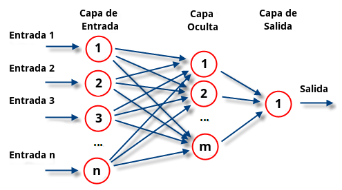

# Qué es una red neuronal

Antes de tirar una sola línea de código tuve que sentarme y entender qué es realmente una **red neuronal**, porque la palabra suena a algo místico que evoca cerebros, sinapsis y consciencia y caminos neuronales y cosas abstractas, pero la realidad es muchísimo más *prosaica*. Una red neuronal es una función. Le metes algo por un lado, en este caso una imagen aplanada de 784 píxeles, y te devuelve algo por el otro, en este caso 10 números que representan probabilidades. La cosa interesante no es la función como objeto matemático, porque eso ya lo conocías del bachillerato o de la high-school; me refiero a que sus parámetros internos se ajustan solos a base de ver ejemplos. Le enseñas miles de imágenes con sus respuestas correctas y la función se va modificando hasta que aprende a generalizar.

El nombre de "neurona" es un préstamo de la biología que más bien estorba que ayuda. Una neurona en este contexto no piensa nada (si se te ocurre pensar que piensa como tal). Una neurona es un número, sin más. O mejor dicho, es una cosa que tiene asociada un número. Por convenio, un número entre cero y uno que representa cuánto se está **activando**. Cuando dibujas un siete y la neurona del dígito siete en la capa de salida tiene un valor de $0.95$, lo que está diciendo el modelo es que con bastante seguridad eso es un siete. Cuando la neurona del cuatro tiene $0.02$, está diciendo que casi no le suena a un cuatro. La red entera no es más que un montón de estos números organizados en capas y conectados entre sí.

## Las capas

Las capas son la estructura general de la red. Avisaré que voy a hablar de mi proyecto en particular, el de predecir que número se escribió en pantalla. Otras pueden no funcionar exactamente como lo voy a indicar.

Hay tres tipos de capas en la red (caso proyecto): la de entrada, las ocultas, y la de salida. La capa de entrada son los píxeles de la imagen. Cada píxel del cuadrado de 28 por 28, después de aplanarlo, se convierte en una neurona con un valor entre cero (negro) y uno (blanco). Eso da $28 \times 28 = 784$ neuronas de entrada, una por píxel. La capa de salida son diez neuronas, una por dígito posible del cero al nueve. La que tenga el valor más alto al final es la predicción del modelo. Y en medio están las capas ocultas, donde de alguna manera mística la red "piensa", aunque pensar es una palabra demasiado generosa para lo que realmente está ocurriendo.

En este proyecto solo hay una capa oculta de 256 neuronas. Podría haber más, dos, tres, diez, pero eso es lo que se llama **deep learning**. Para los fundamentos una capa oculta es suficiente y muchísimo más fácil de debuggear cuando algo se rompe (que se romperá, créeme). Entender los fundamentos, entonces, me resultaba más importante. Añadir más capas luego me sería trivial.

## Pesos, biases, y la fórmula central

Cada neurona de una capa está conectada a todas las neuronas de la capa siguiente. Si tienes 784 entradas y 256 neuronas en la capa oculta, hay $784 \times 256 = 200{.}704$ conexiones. Cada conexión tiene un peso, que es otro número. Los pesos son lo que se ajusta durante el entrenamiento. Al principio los pesos son aleatorios, son disparates absolutos, y por eso una red recién creada predice basura.

El cálculo que hace una neurona individual es lo más sencillo del mundo. Coges los valores de todas las neuronas de la capa anterior, los multiplicas cada uno por su peso correspondiente, los sumas todos, le añades un sesgo (el bias, que es como un ajuste fino que cada neurona tiene aparte de los pesos), y al resultado le aplicas una función que aplasta el número en un rango concreto. Esa última función es la función de activación. En notación matemática, para una neurona $j$ de la capa actual:

$$z_j = \sum_{i} w_{ji} \cdot a_i + b_j$$

$$a_j' = \sigma(z_j)$$

Donde $a_i$ son las activaciones de la capa anterior, $w_{ji}$ son los pesos que conectan la neurona $i$ con la neurona $j$, $b_j$ es el bias, $z_j$ es la pre-activación (el resultado antes de aplicar la función de activación), y $\sigma$ es la función de activación. La $a_j'$ es la nueva activación, la que se pasará a la capa siguiente.

Esa fórmula la vas a ver mil veces en el resto de notas. Vale la pena releerla varias veces hasta que sea evidente qué hace cada cosa. Toma los inputs, los pondera con los pesos, suma el bias, y aplasta el resultado, siendo aplastar la función sigmoide. Luego vemos de qué se trata esta función y por qué la necesitamos.

Cuando lo escribes así para una sola neurona, parece tonto. Pero cuando lo extiendes a las 256 neuronas de la capa oculta a la vez, se vuelve un montón de operaciones. Por eso usamos numpy. Numpy es una librería de Python que hace todas estas multiplicaciones y sumas en una sola línea, vectorizadas, sin que tengamos que escribir bucles a mano. Toda la capa se calcula con un único $\mathbf{z} = W\mathbf{a} + \mathbf{b}$, donde $W$ es una matriz que contiene todos los pesos, $\mathbf{a}$ es el vector de activaciones de la capa anterior, y $\mathbf{b}$ es el vector de biases. Eso se llama forward pass y es la parte fácil de la red.

## La función de activación, ¿y por qué?

¿Por qué hay que meterle una función de activación al final del cálculo de cada neurona? La respuesta corta es que sin función de activación la red entera colapsa a algo lineal, y una red lineal no puede aprender nada interesante. La respuesta larga necesita un poco de matemática.

Si quitas la función de activación, cada capa hace simplemente $z = Wa + b$, que es una transformación lineal. Si encadenas dos capas lineales, lo que tienes es otra transformación lineal. Es decir, $W_2(W_1 a + b_1) + b_2$ se puede reescribir como una sola $W'a + b'$ con pesos diferentes. Da igual cuántas capas pongas, una red lineal de cien capas es matemáticamente equivalente a una red lineal de una sola capa. Lo cual es un desperdicio total de tiempo.

La función de activación introduce no-linealidad. Eso permite a la red aprender relaciones complicadas, no solo combinaciones lineales de los inputs. Las que usé son [[NN-03 Sigmoid y la primera derivada|sigmoid]] para la capa oculta y [[NN-04 Softmax|softmax]] para la capa de salida. La razón de que sean diferentes tiene su gracia y la cuento en sus respectivas notas, pero adelanto la idea: sigmoid hace una cosa neurona por neurona y aplasta cada una al rango $[0, 1]$, mientras que softmax hace una cosa coordinada entre todas las neuronas de la misma capa al mismo tiempo, lo cual la hace ideal para representar probabilidades sobre las diez clases.

Sigmoid en su forma más pura es:

$$\sigma(x) = \frac{1}{1 + e^{-x}}$$

Si le metes un número grande, te devuelve algo cercano a 1. Si le metes un número muy negativo, te devuelve algo cercano a 0. Si le metes 0, te devuelve 0.5. Es una S suave que pasa por el centro. Tiene su propia nota porque hay que derivarla y eso ya da más juego.

## ¿Y por qué la red aprende?

Aquí entra la parte que más costó entender, y la que tiene más conexiones con cosas que pasan en la vida fuera de las redes neuronales. La red al principio es un completo desastre, es un pequeño *bebé ovaloide*. Le metes una imagen y te suelta una predicción aleatoria, porque sus pesos son aleatorios. ¿Cómo sabe que se ha equivocado? Pues porque tú le das la respuesta correcta. Le dices "esto era un tres, no un siete". Entonces se calcula cuánto se ha equivocado con una función llamada coste, que es básicamente un número que representa la magnitud del error. Ese número es lo que vamos a intentar minimizar. Entonces...

Cada peso individual de la red tiene una influencia concreta sobre el coste final. Un peso muy importante hará que el coste cambie mucho si lo modificas. Un peso poco importante hará que el coste cambie poco. Lo que mide esa influencia es la [[CON-derivada parcial|derivada parcial]] del coste respecto al peso. Si la derivada es positiva, significa que aumentar el peso aumentaría el error, así que debes disminuirlo. Si es negativa, aumentar el peso reduciría el error, así que debes aumentarlo. La regla de actualización en su forma más simple es:

$$w \leftarrow w - \eta \cdot \frac{\partial C}{\partial w}$$

Donde $\eta$ es el learning rate, un número pequeño que controla cuánto cambias el peso en cada paso (PD: el nombre de la letra griega es gracioso). Esto se hace para todos los pesos a la vez, en cada iteración del entrenamiento. La técnica entera se llama [[CON-gradient descent|gradient descent]] y es la base de todo el aprendizaje en redes neuronales y en muchísimos otros sitios.

Pensemos esto un momento como si no fuera matemática. Imagina que estás intentando reducir tu nivel de estrés. Tienes diez actividades diarias, cada una contribuye en distinta medida a tu estrés. Si quieres bajarlo, no vas a tocarlas todas por igual. Vas a identificar cuáles son las que más te tensan y vas a ajustar más esas, mientras que las que apenas te afectan las dejas en paz. La red hace exactamente lo mismo, solo que con doscientos mil pesos en vez de diez actividades, y "el estrés" es el error de predicción. La diferencia es que la red tiene la suerte (o la pesadez) de poder calcular exactamente cuánto contribuye cada peso, mientras que tú solo tienes intuición.

El problema es que entre un peso de la primera capa y el coste final hay capas enteras de cálculos por en medio. ¿Cómo calculas la derivada del coste respecto a un peso que está enterrado tres capas atrás? Pues con la [[CON-regla de la cadena|regla de la cadena]] aplicada hacia atrás desde el coste hasta el peso. Y eso es [[NN-07 Backpropagation|backpropagation]], que es el corazón del proyecto y la nota donde más sangre dejé; a día de hoy no sé cómo la hice.

## Resumen

Como esto es la nota inicial, vale la pena cerrar con un repaso del ciclo completo, aunque luego cada paso tenga su nota propia donde lo destripo en detalle.

Primero está el forward pass. Le metes una imagen a la red y la imagen va pasando capa por capa. En cada capa se calcula $z = Wa + b$, se le aplica la función de activación, y el resultado pasa a la siguiente capa. Al final sale un vector de 10 probabilidades.

Después está el cálculo del coste. Comparas esas 10 probabilidades con la respuesta correcta y obtienes un número que dice cuánto se equivocó la red. La función que usé es [[NN-05 Cross-entropy|cross-entropy]], que tiene su nota porque también tiene su gracia.

Después está backpropagation. Recorres la red al revés, desde el coste hasta los pesos de la primera capa, calculando las derivadas con la regla de la cadena. Esto te da $\frac{\partial C}{\partial w}$ para cada peso de la red.

Y finalmente está la actualización de pesos. Aplicas $w \leftarrow w - \eta \cdot \frac{\partial C}{\partial w}$ a cada peso. La red se ha ajustado un poquito en la dirección correcta.

Repites todo esto miles y miles de veces, una por cada imagen del dataset, durante varias épocas (una época significa pasar el dataset entero una vez). Y al final, mágicamente, la red aprende a reconocer dígitos. Puf. Parece magia. Pero si es que lo es. Pero es que joder, si no tenemos ni idea de por qué funciona tan bien, ¡pero funciona!

## Lo que no es una red neuronal

Es importante terminar esta nota mirando lo que esto no es, porque la palabra "neuronal" hace que la gente piense cosas no tan correctas. Una red neuronal no piensa. No entiende lo que ve. No tiene consciencia, intuición, razón, emoción ni ganas de existir. Una red neuronal entrenada con MNIST aprende a distinguir dígitos porque ha visto sesenta mil ejemplos y de ellos ha extraído patrones estadísticos sobre qué disposiciones de píxeles tienden a corresponder con qué número. Si le metes la imagen de un gato, te va a decir que es un dígito, porque eso es lo único que sabe hacer. No te va a decir "oye, esto es raro, esto no es un número", no tiene esa capacidad. Cuando alguien dice que la IA va a sentir o se va a rebelar, generalmente está extrapolando capacidades que las redes simplemente no tienen. Aunque, claro, los modelos modernos como los de OpenAI, Google, o Claude son redes neuronales muchísimo más grandes y complejas, y ahí la conversación se pone más interesante. Pero para una red de tres capas con 200 mil parámetros entrenada para reconocer dígitos, hablamos de algo bastante humilde.

## La arquitectura concreta de este proyecto

Para que quede claro y poder referirme a esto cuando aparezca en otras notas: la red tiene 784 neuronas de entrada, una capa oculta de 256 neuronas con sigmoid, y una capa de salida de 10 neuronas con softmax. En total son alrededor de $784 \cdot 256 + 256 + 256 \cdot 10 + 10 \approx 203{.}530$ parámetros (pesos más biases) que se ajustan durante el entrenamiento. Doscientos mil números que empiezan siendo aleatorios y acaban encajando perfectamente para reconocer dígitos.

Si te da cosa ver ese número, piensa que GPT-4 (versión antigua) tiene alrededor de un billón de parámetros. La diferencia es absurda, pero bro, la idea es la misma. Y eso es lo impresionante. Algo tan grande se reduce a algo tan pequeño como eso.