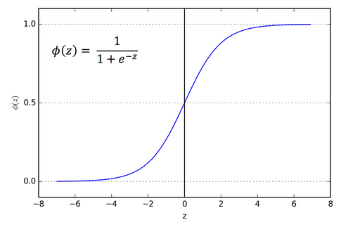

La primera función real del proyecto fue sigmoid. La elección no fue mía, en realidad. Sigmoid es la función de activación clásica, la que aparece en cualquier vídeo introductorio de redes neuronales, la que te encuentras en los libros antiguos de machine learning antes de que ReLU se hiciera el rey. Hay otras opciones más modernas y de hecho mejores para redes profundas, pero para una red pequeña con una sola capa oculta, sigmoid funciona perfectamente bien y tiene la ventaja gigante de que es muy fácil de derivar. Y derivar es lo que vamos a tener que hacer en backpropagation, así que cualquier facilidad es bienvenida.

La fórmula es esta:

$$\sigma(x) = \frac{1}{1 + e^{-x}}$$

Si la miras un momento te das cuenta de lo que hace. Si $x$ es muy grande, $e^{-x}$ se va a cero, así que $\sigma(x)$ se va a $\frac{1}{1+0} = 1$. Si $x$ es muy negativo, $e^{-x}$ se va a infinito, así que $\sigma(x)$ se va a $\frac{1}{1+\infty} = 0$. Y si $x = 0$, $e^{-x} = 1$, así que $\sigma(0) = \frac{1}{2}$. Lo que hace sigmoid es coger cualquier número de la recta real y aplastarlo entre 0 y 1, pasando por 0.5 en el origen. Es una S suave, una curva gigachad sigma.




## ¿Por qué se usa sigmoid?

La razón principal es que aplasta los valores. Recuerda que en la fórmula central de una red, $z = Wa + b$, el resultado puede ser cualquier número, positivo o negativo, grande o pequeño. Si vas pasando esos números brutos de capa en capa sin aplastarlos, se descontrolan. Acabas con neuronas que tienen activaciones de magnitudes enormes y otras que están muertas, y la red no aprende nada bueno.

Sigmoid soluciona eso de una forma muy limpia. Cualquier cosa que entre, sale como una probabilidad de activación entre 0 y 1. Es como un factor de "cuánto se enciende esta neurona". Cero es apagada, uno es encendida al máximo, y los valores intermedios son grados de activación. Esa interpretación de "encendida o apagada" es la que conecta con la analogía biológica original de las neuronas (aunque, como dije en [[NN-02 Qué es una red neuronal]], la analogía biológica es más un préstamo que una verdad, y jode en realidad una barbaridad).

Hay un problema con sigmoid que hay que mencionar aunque en este proyecto no afectó, pero me lo dijo una buena amiga (la IA). Cuando $x$ es muy grande o muy pequeño, la curva se aplana. La derivada en esas zonas es prácticamente cero. Y si la derivada es cero, gradient descent no puede ajustar bien los pesos en esa zona, porque la dirección que indica la derivada es prácticamente nula. Eso se llama "vanishing gradient problem" y es la razón, quizás —lo que creo— por la que en redes profundas se usa ReLU en lugar de sigmoid. Pero como esto es una red de una sola capa oculta, no llegamos a sufrir el problema. Funcionar, funciona. Así que ya está.

## Derivar sigmoid a mano

Esta fue la primera derivada del proyecto y la primera donde sentí que estaba haciendo algo de matemáticas en serio, pero es un ejercicio, sin más. Y voy a contar el proceso entero porque es lo que viví.

Para derivar $\sigma(x) = \frac{1}{1 + e^{-x}}$ usé la regla del cociente. La regla del cociente dice que si tienes $\frac{u}{v}$, su derivada es $\frac{u'v - uv'}{v^2}$. En nuestro caso $u = 1$ (constante, su derivada es cero) y $v = 1 + e^{-x}$ (su derivada es $-e^{-x}$, porque la derivada de $e^{-x}$ es $-e^{-x}$ por la regla de la cadena). Aplicando la fórmula:

$$\sigma'(x) = \frac{0 \cdot (1 + e^{-x}) - 1 \cdot (-e^{-x})}{(1 + e^{-x})^2} = \frac{e^{-x}}{(1 + e^{-x})^2}$$

Hasta aquí llegué solo. Y pensé "vale, ya está, esta es la derivada de sigmoid". La fórmula es correcta. Numéricamente es la respuesta exacta. Pero hay una cosa que no me cuadraba, porque para corroborarlo busqué en internet la solución original.

En todos los sitios que había mirado, la derivada de sigmoid se escribía como $\sigma(x) \cdot (1 - \sigma(x))$. Y mi resultado parecía completamente diferente. Pasé un buen rato confundido pensando que había hecho algo mal, comparando los signos, recalculando. La duda era legítima: ¿cómo es que mi $\frac{e^{-x}}{(1 + e^{-x})^2}$ es lo mismo que $\sigma(x) \cdot (1 - \sigma(x))$? No se parecen ni de lejos a primera vista.

Tonto de mí, jajska. Resulta que eran exactamente lo mismo. Solo que escritos de forma distinta. El truco está en sumar y restar 1 en el numerador y separar fracciones.

Empezamos con:

$$\sigma'(x) = \frac{e^{-x}}{(1 + e^{-x})^2}$$

Reescribimos el $e^{-x}$ del numerador como $(1 + e^{-x}) - 1$:

$$\sigma'(x) = \frac{(1 + e^{-x}) - 1}{(1 + e^{-x})^2}$$

Y separamos la fracción:

$$\sigma'(x) = \frac{1 + e^{-x}}{(1 + e^{-x})^2} - \frac{1}{(1 + e^{-x})^2}$$

El primer término simplifica:

$$\sigma'(x) = \frac{1}{1 + e^{-x}} - \frac{1}{(1 + e^{-x})^2}$$

Entonces... el primer término es $\sigma(x)$ por definición. El segundo término es $\sigma(x)^2$, porque elevar al cuadrado una fracción equivale a elevar al cuadrado el denominador. Así que:

$$\sigma'(x) = \sigma(x) - \sigma(x)^2 = \sigma(x) \cdot (1 - \sigma(x))$$

¡Bien! Por fin. Mi derivada y la de los artículos son la misma cosa.

## ¿Por qué importa esa forma alternativa?

Es simple coste computacional. Te lo dejo de tarea.

Por eso en el código del proyecto, la función `diff_sigmoid` está escrita así:

```python
def diff_sigmoid(x: float) -> float:
    return sigmoid(x) * (1 - sigmoid(x))
```

En realidad, en backpropagation hago algo todavía mejor: como tengo guardada la activación $S$ después de aplicar sigmoid en el forward pass, puedo usarla directamente sin recalcular $\sigma(x)$. La derivada se reduce a `eso de arriba` y no llamo a sigmoid en absoluto. Cero exponenciales en backpropagation.

## Recapitulación

Antes de cerrar la nota, recapitulemos:

Sigmoid es $\sigma(x) = \frac{1}{1 + e^{-x}}$. Aplasta cualquier número de la recta real al rango $[0, 1]$.

Su derivada es $\sigma'(x) = \sigma(x) \cdot (1 - \sigma(x))$, que se puede deducir derivando la fórmula original con la regla del cociente y haciendo un truco algebraico para reescribirla de forma más útil.

Esa forma alternativa es eficiente porque, durante backpropagation, ya tenemos $\sigma(x)$ calculado del forward pass. Usar la forma $\sigma(x)(1 - \sigma(x))$ ahorra recalcular exponenciales.

Sigmoid funciona bien para redes pequeñas pero tiene el problema del vanishing gradient en redes profundas, lo cual no afecta a este proyecto porque solo hay una capa oculta. Para redes más grandes se usa ReLU.

Con esto cerrado, la siguiente función que entró fue softmax, que sirve para la capa de salida y tiene una historia más rara que la de sigmoid. La cuento en [[NN-04 Softmax]].