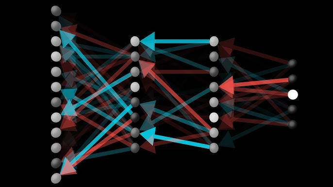

# Backpropagation

Si tuviera que apuntar el momento del proyecto donde más cerca estuve de cerrar el editor y volver a... yo que sé... a mi vida, fue aquí.

Backpropagation es el algoritmo que permite que una red neuronal aprenda. Sin esto, todo lo construido hasta ahora (las funciones, las capas, el forward pass) sería una calculadora sofisticada con pesos aleatorios. La red podría predecir, pero predeciría mal y nunca mejoraría. Backprop es lo que cierra el bucle porque le permite a la red ajustar sus pesos en la dirección correcta a partir del error que comete.



## ¿Qué hace backpropagation, en una frase?

Backpropagation calcula, para CADA PESO DE LA RED, cuánto contribuye al error final. Con esa información, gradient descent puede ajustar cada peso en la dirección que reduce el error. Pero el cálculo no es trivial cuando hay múltiples capas, porque entre un peso de la primera capa y el coste final hay capas enteras de cálculos por en medio.

La herramienta matemática que resuelve esto es la [[CON-regla de la cadena|regla de la cadena]] aplicada hacia atrás desde el coste hasta cada peso. De ahí viene el nombre: el error se "propaga hacia atrás" a través de la red.

## Planteamiento

Para entender backprop, lo primero es ver el camino que recorre una imagen al pasar por la red. Yo lo dibujé en una pizarra con esta notación:

$$W \to Z \to S \to C$$

Donde $W$ son los pesos, $Z$ es la pre-activación ($Wa + b$), $S$ es la activación (después de sigmoid o softmax), y $C$ es el coste. Eso es el forward pass de una capa, vagamente.

Si quiero saber cómo afecta un peso al coste, tengo que recorrer ese camino al revés con la regla de la cadena:

$$\frac{\partial C}{\partial W} = \frac{\partial C}{\partial S} \cdot \frac{\partial S}{\partial Z} \cdot \frac{\partial Z}{\partial W}$$

Cada fracción es una [[CON-derivada parcial|derivada parcial]] de un paso del camino. Las multiplicas todas y obtienes cuánto afecta $W$ al coste final.

Hasta ahí bien. El problema es que esto es para los pesos de la última capa. Para los pesos de capas anteriores, el camino es más largo, y la regla de la cadena se extiende. Y aquí es donde empecé a perderme.

## El tema de los "caminos"

Cuando intenté generalizar a dos capas, escribí algo así:

$$x \to W_1 \to Z_1 \to S_1 \to W_2 \to Z_2 \to S_2 \to C$$

Y dibujé la cadena de derivadas para $\frac{\partial C}{\partial W_1}$. La cosa quedaba en algo tipo:

$$\frac{\partial C}{\partial W_1} = \frac{\partial C}{\partial S_2} \cdot \frac{\partial S_2}{\partial Z_2} \cdot \frac{\partial Z_2}{\partial W_2} \cdot \frac{\partial W_2}{\partial S_1} \cdot \frac{\partial S_1}{\partial Z_1} \cdot \frac{\partial Z_1}{\partial W_1}$$

Y aquí algo no me cuadraba. Ese término $\frac{\partial W_2}{\partial S_1}$ era raro, $W_2$ es independiente de $S_1$, son matrices de pesos que vienen de la inicialización. Su derivada parcial debería ser cero, pero entonces toda la cadena se anula y eso no tiene sentido. Algo estaba mal.

Pasé un buen rato dándole vueltas. ¿Por qué $W_2$ aparece en la cadena si no depende de $S_1$? Probé varios caminos. Reescribí la cadena de mil maneras. Empecé a dudar de si la regla de la cadena se aplicaba como yo creía. Llegué a pensar que estaba mal el camino entero.

Pero finalmente me di cuenta que el camino verdadero es:

$$x \to Z_1 \to S_1 \to Z_2 \to S_2 \to C$$

Sin $W_1$ ni $W_2$ explícitos en el camino. Los pesos no son parte del flujo, son parámetros que **definen las transiciones**. $Z_1$ se calcula a partir de $x$ usando $W_1$, pero $W_1$ no es un nodo del camino. Es un coeficiente.

Cuando deriva $\frac{\partial C}{\partial W_1}$, $W_1$ es la variable respecto a la cual derivas, no un nodo del camino. Y el camino es:

$$\frac{\partial C}{\partial W_1} = \frac{\partial C}{\partial S_2} \cdot \frac{\partial S_2}{\partial Z_2} \cdot \frac{\partial Z_2}{\partial S_1} \cdot \frac{\partial S_1}{\partial Z_1} \cdot \frac{\partial Z_1}{\partial W_1}$$

Y ahora sí. Cada término es una derivada parcial concreta y calculable. El término $\frac{\partial Z_2}{\partial S_1}$ es justamente $W_2$ (porque $Z_2 = W_2 \cdot S_1 + b_2$, y derivar respecto a $S_1$ deja $W_2$). Y ahí es donde $W_2$ aparece naturalmente, sin necesidad de inventarse derivadas raras como $\frac{\partial W_2}{\partial S_1}$.

Fue un "joder, que tonto soy" mezclado con "qué bonito es esto cuando lo entiendes". Toda la confusión venía de tratar a los pesos como nodos del grafo cuando en realidad son etiquetas de las aristas, unos parámetros que controlan cómo un nodo se transforma en el siguiente.

## Las piezas concretas

Una vez entendido el camino, hay que calcular cada derivada parcial. Las tres piezas básicas son:

**$\frac{\partial Z}{\partial W}$**: $Z = W \cdot S_{\text{anterior}} + b$, así que la derivada respecto a $W$ es $S_{\text{anterior}}$. Las activaciones de la capa anterior.

**$\frac{\partial Z}{\partial b}$**: derivar $W \cdot S + b$ respecto a $b$ da 1.

**$\frac{\partial S}{\partial Z}$**: depende de la función de activación. Para sigmoid, es $\sigma'(Z) = S \cdot (1 - S)$ (que ya derivamos en [[NN-03 Sigmoid y la primera derivada]]). Para softmax, es complicado y hay que hacer trampa con cross-entropy.

**$\frac{\partial C}{\partial S}$**: depende de la función de coste. Para cross-entropy con softmax en la última capa, sucede el milagro: la combinación de softmax y cross-entropy se simplifica directamente a $S - y$ cuando lo derivas respecto a la pre-activación $Z$. Eso es lo que cuenta [[NN-04 Softmax]] y [[NN-05 Cross-entropy]].

## Recordemos el truquito: $\frac{\partial C}{\partial Z_2} = S - y$

En lugar de calcular $\frac{\partial C}{\partial S_2} \cdot \frac{\partial S_2}{\partial Z_2}$ por separado y multiplicar (lo cual implicaría derivar softmax con sus dos casos por separado, una pesadilla), usamos la combinación directa:

$$\frac{\partial C}{\partial Z_2} = S_2 - y$$

Predicción menos real. Esa es la "señal de error" que sale de la última capa. Y es el punto de partida real de backprop. A partir de ahí, todo es propagación hacia atrás reutilizando lo ya calculado.

## El algoritmo completo, paso a paso

Después de pelearme con la teoría, lo expresé como una secuencia de cálculos concretos. Esta es la lista que escribí en mi cuaderno y que luego traduje a código en base a mirar todas las dimensiones de todo el mundo para que todo cuadrada:

1. **$dZ_2 = S_2 - y$** — error en la última capa.
2. **$dW_2 = dZ_2 \otimes S_1$** — gradiente de los pesos de la última capa, usando producto exterior.
3. **$db_2 = dZ_2$** — gradiente del bias de la última capa.
4. **$dS_1 = W_2^T \cdot dZ_2$** — propagar el error hacia la capa anterior.
5. **$dZ_1 = dS_1 \odot \sigma'(Z_1)$** — multiplicar por la derivada de sigmoid (elemento a elemento).
6. **$dW_1 = dZ_1 \otimes x$** — gradiente de los pesos de la primera capa.
7. **$db_1 = dZ_1$** — gradiente del bias de la primera capa.

Donde $\otimes$ es el [[CON-producto exterior|producto exterior]] (que da una matriz a partir de dos vectores) y $\odot$ es la multiplicación elemento a elemento. Cada paso reutiliza el cálculo del paso anterior. Eso es lo que hace que backprop sea eficiente: no recalculas nada, vas propagando el error capa por capa hacia atrás reutilizando los valores de cada paso.

Una vez calculados los gradientes, la actualización de pesos es trivial:

$$W \leftarrow W - \eta \cdot dW$$

$$b \leftarrow b - \eta \cdot db$$

Donde $\eta$ es el learning rate. Eso es [[CON-gradient descent|gradient descent]], sin más.

## El producto exterior

Cuando llegamos al paso $dW_2 = dZ_2 \otimes S_1$, hay una sutileza importante. $dZ_2$ es un vector de 10 elementos (uno por neurona de salida), y $S_1$ es un vector de 256 elementos (uno por neurona oculta). $dW_2$ tiene que ser una matriz de $10 \times 256$, igual que $W_2$.

¿Cómo conviertes dos vectores en una matriz? Con el producto exterior. El producto exterior de un vector $a$ de tamaño $n$ y un vector $b$ de tamaño $m$ es una matriz de $n \times m$ donde el elemento $(i, j)$ es $a_i \cdot b_j$. Eso da exactamente lo que queremos. Pensándolo, cada elemento de $dW_2$ está asociado a un peso concreto que conecta una neurona oculta con una neurona de salida. Y el gradiente de ese peso es "cuánto contribuye esa neurona oculta a esa neurona de salida", que es justamente $dZ_2[i] \cdot S_1[j]$. La estructura de la matriz refleja la estructura de la red.

En código numpy es `np.outer(dZ2, S1)`. Lo cuento con más detalle en [[CON-producto exterior]].

## La transpuesta en $dS_1 = W_2^T \cdot dZ_2$

El paso de propagar el error a la capa anterior ($dS_1$) requiere una transposición. ¿Por qué? Porque las dimensiones tienen que cuadrar. $W_2$ tiene forma $(10, 256)$, $dZ_2$ tiene forma $(10,)$. Para que la multiplicación matriz-vector dé un resultado de tamaño 256 (que es lo que tiene $S_1$), necesitas que la matriz esté en forma $(256, 10)$, que es $W_2^T$. Entonces $W_2^T \cdot dZ_2$ es $(256, 10) \cdot (10,) = (256,)$. Cuadra.

Esa transposición no es solo un truco para que las dimensiones cuadren, tiene sentido geométrico. La matriz $W_2$ describe cómo cada neurona oculta contribuye a cada neurona de salida. Su transpuesta describe lo opuesto: cómo cada neurona de salida proviene de cada neurona oculta. Y eso es exactamente lo que necesitas para propagar el error en sentido contrario al forward pass.

## La implementación

Aquí está la función `backprop` traducida del cuaderno al código. Es la función más importante del proyecto y la que más veces revisé:

```python
def backprop(self, input, predictions, correct_index, learning_rate):
    # dC/dZ2 = S - y
    y = np.zeros(10)
    y[correct_index] = 1
    dZ2 = predictions - y

    # dC/dW2 = dZ2 prod.ext S1
    dW2 = np.outer(dZ2, self.layers[-2].S)
    db2 = dZ2

    # propagar hacia la capa oculta
    dS1 = self.layers[-1].weights.T @ dZ2
    dZ1 = dS1 * diff_sigmoid(self.layers[-2].Z)

    # gradientes de la capa oculta
    dW1 = np.outer(dZ1, input)
    db1 = dZ1

    # actualización
    self.layers[-1].weights -= learning_rate * dW2
    self.layers[-1].bias    -= learning_rate * db2
    self.layers[-2].weights -= learning_rate * dW1
    self.layers[-2].bias    -= learning_rate * db1
```

Esa función la escribí siguiendo paso a paso la lista de cálculos que tenía en el cuaderno. Cuando la ejecuté por primera vez sobre MNIST y vi que la red empezaba a aprender (el coste bajaba época a época), fue probablemente el momento más satisfactorio del proyecto entero.

## Pero dejé la deuda de aprender por qué...

...la derivada combinada de softmax y cross-entropy se simplifica a $S - y$. Esa simplificación es algebra que se cancela limpiamente cuando juntas las dos funciones, pero requiere derivar softmax con sus dos casos (cuando $i = j$ y cuando $i \neq j$) y multiplicar por la derivada de cross-entropy. Es un ejercicio que vale la pena hacer despacio, pero lo dejé para más adelante.

## Lo que me llevo de esta cosa

La regla de la cadena no es algo que se memoriza, es algo que se entiende cuando ves que el camino del forward pass se recorre al revés en el backprop. Cada flecha del forward es una derivada parcial en el backprop.

Los pesos no son nodos del grafo, son parámetros que controlan las transiciones entre nodos. Esto parece obvio cuando lo escribes, pero confunde un montón mientras intentas dibujar la cadena de derivadas.

El producto exterior es la operación natural cuando quieres reconstruir una matriz de gradientes a partir de dos vectores. La transposición es la operación natural cuando quieres propagar información en sentido contrario al forward pass.

La combinación de softmax y cross-entropy no es coincidencia. Esas dos funciones se diseñaron para que sus derivadas se cancelen y dejen una expresión limpia. Eso refleja una cosa que se ve mucho en matemáticas aplicadas: cuando dos cosas se llevan bien, la teoría se simplifica.

Y por último, lo más importante: **escribir la matemática con tus propias palabras y derivar las cosas a mano hace una diferencia enorme**. Yo había visto backpropagation explicado en vídeos, libros, blogs, antes de empezar este proyecto. Pero hasta que no me senté a derivar cada paso, a equivocarme con los caminos, a probar varias formas de escribir la cadena, no la entendí bien bien, digamos. Ese sufrimiento no se puede saltar. Es parte del aprendizaje. Y a mí me encantó.

## Recapitulación

Backpropagation aplica la regla de la cadena para calcular el gradiente del coste respecto a cada peso de la red.

El camino del forward pass es $x \to Z_1 \to S_1 \to Z_2 \to S_2 \to C$. Backprop lo recorre al revés calculando cada derivada parcial.

La señal inicial es $dZ_2 = S_2 - y$, gracias al milagro algebraico de softmax + cross-entropy.

Para cada capa, calculamos $dW$ con producto exterior y propagamos el error hacia atrás con la transpuesta de los pesos. Multiplicamos por la derivada de sigmoid cuando llegamos a la pre-activación.

Una vez calculados los gradientes, gradient descent los aplica para actualizar los pesos.

Con backprop implementado, la red ya puede aprender. El siguiente paso es meterle datos y ver qué pasa, en [[NN-08 Implementación con MNIST]].