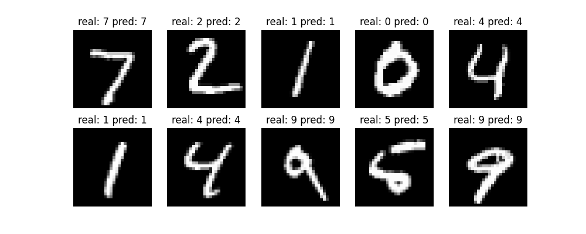
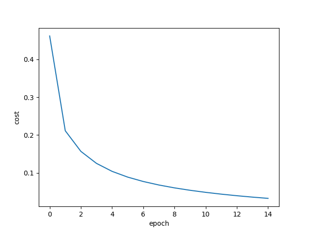

Llegado a este punto la red ya tenía todo lo necesario: las capas, el forward pass, backpropagation. Faltaba enchufarle datos reales y ver si lo que había construido durante días aprendía algo o se quedaba en una construcción matemáticamente bonita pero estéril.

MNIST es el dataset estándar para esto. Son 70.000 imágenes de dígitos escritos a mano, 60.000 para entrenar y 10.000 para evaluar. Cada imagen es de $28 \times 28$ píxeles en escala de grises. Es el "hola mundo" del machine learning según me dijeron, y el primer dataset que toca todo el mundo, y por buenas razones: es pequeño, está limpio, y resuelve un problema lo suficientemente difícil como para ser interesante pero lo suficientemente simple como para que una red básica lo resuelva bien.



## Cargar MNIST

Para no andar descargando archivos a mano, usé `keras.datasets`, que tiene MNIST integrado:

```python
from keras.datasets import mnist
(x_train, y_train), (x_test, y_test) = mnist.load_data()
```

Eso te da cuatro arrays. `x_train` es de forma $(60000, 28, 28)$, las 60.000 imágenes de entrenamiento. `y_train` es de forma $(60000,)$, las etiquetas correspondientes (números del 0 al 9). `x_test` y `y_test` son lo mismo pero con las 10.000 imágenes de evaluación.

Antes de meter los datos en la red, hay dos pasos de preprocesamiento que toca hacer.

**Aplanar.** Mi red espera vectores de 784 elementos como entrada, no matrices de $28 \times 28$. Hay que aplanar cada imagen.

**Normalizar.** Los píxeles vienen como enteros entre 0 y 255 (escala de grises tradicional). Las redes neuronales funcionan mucho mejor con valores pequeños, idealmente entre 0 y 1. Si trabajas con números grandes, los gradientes se descontrolan y el entrenamiento se desestabiliza. Dividir entre 255 es la solución estándar.

```python
x_train = x_train.reshape(60000, 784) / 255.0
x_test  = x_test.reshape(10000, 784) / 255.0
```

Una línea para cada conjunto. Ahora cada imagen es un vector plano de 784 valores entre 0 y 1.

## El bucle de entrenamiento

El bucle de entrenamiento es la parte más simple del proyecto, pero también la que da más satisfacción cuando ves que funciona. La estructura es:

```python
for epoch in range(epochs):
    for i in range(len(x_train)):
        data = x_train[i]
        predictions = network.forward(data)
        network.backprop(data, predictions, y_train[i], learning_rate)
```

Una **época** es una pasada completa por el dataset. Si tienes 60.000 imágenes y haces 10 épocas, la red ve cada imagen 10 veces. Cada vez ajusta sus pesos un poquito en la dirección correcta. La red no aprende de golpe, aprende con miles de pequeños ajustes que acumulados dan una mejora enorme.

Una pregunta natural es: ¿cuántas épocas son suficientes? La respuesta corta es "depende". Pocas épocas y la red no ha aprendido lo suficiente. Demasiadas y la red se sobreajusta a los datos de entrenamiento, memorizando casos concretos en lugar de generalizar. Empecé con 10 y luego subí a 15. Para esta red y este dataset, alrededor de 15 está bien.

¿Y por qué la red no aprende todo de la primera pasada? Porque el learning rate es pequeño. Cada actualización mueve los pesos solo un poquito en la dirección correcta, no de golpe. Esa lentitud es deliberada: si los pesos cambiaran demasiado en cada paso, la red oscilaría sin converger. Es preferible avanzar poco a poco, muchas veces, que dar saltos enormes que pasan de largo el mínimo del coste.

## Registrar el coste

Para poder ver gráficamente que la red está aprendiendo, registro el coste de cada época:

```python
costs = []

for epoch in range(epochs):
    cost_epoch = 0
    for i in range(len(x_train)):
        data = x_train[i]
        predictions = network.forward(data)
        network.backprop(data, predictions, y_train[i], learning_rate)
        cost_epoch += cross_entropy(predictions, y_train[i])
    
    costs.append(cost_epoch / len(x_train))
    print(f"epoch {epoch + 1} completed. cost: {costs[-1]:.4f}")
```

El coste medio de cada época se va acumulando en una lista, y al final lo grafico con matplotlib. La curva tiene una forma muy reconocible: empieza alta, baja rápido las primeras épocas, y luego se va aplanando. Es la curva de aprendizaje clásica.



## La evaluación

Una vez entrenada la red, hay que ver cuánto acierta sobre datos que nunca vio. Para eso están las 10.000 imágenes de test:

```python
precision = 0
for i in range(len(x_test)):
    predictions = network.forward(x_test[i])
    if np.argmax(predictions) == y_test[i]:
        precision += 1

print(f"Precision: {precision / 10000 * 100}%")
```

`np.argmax(predictions)` devuelve el índice del valor más alto, que en este caso es el dígito que la red predice. Si coincide con la etiqueta correcta, sumamos al contador. Al final dividimos entre el total y multiplicamos por 100 para obtener el porcentaje.

La primera vez que ejecuté esto y vi un **97.82%** de precisión, no me lo creí. Una red entera construida desde cero, con matemáticas que había derivado a mano, reconocía dígitos escritos a mano con menos del 3% de error. Y eso sin ningún framework o cosas de esas.

## Guardar los pesos

Un detalle práctico: entrenar la red tarda varios minutos. No tiene sentido reentrenarla cada vez que quieras evaluarla o usarla en otro contexto (como el visualizador web). Por eso al final del entrenamiento guardo los pesos en archivos:

```python
np.save('w1.npy', network.layers[0].weights)
np.save('b1.npy', network.layers[0].bias)
np.save('w2.npy', network.layers[1].weights)
np.save('b2.npy', network.layers[1].bias)
```

Y en otro script (`evaluate.py`) los cargo directamente sin reentrenar:

```python
network.layers[0].weights = np.load('w1.npy')
network.layers[0].bias    = np.load('b1.npy')
network.layers[1].weights = np.load('w2.npy')
network.layers[1].bias    = np.load('b2.npy')
```

Esto separa "entrenar" de "usar". Entrenas una vez, guardas los pesos, y luego ya puedes evaluar y usar la red las veces que quieras sin esperar.

## El primer 97% (y por qué no es suficiente)

97.82% suena espectacular, y sobre el conjunto de test lo es. Pero cuando luego construí el visualizador web (que viene en [[NN-11 El visualizador web]]) y empecé a dibujar dígitos a mano con el ratón, la red fallaba mucho más de lo que el 97% sugería. Fallaba en sietes. Fallaba en cuatros si los dibujaba con el trazo demasiado fino. Fallaba en cualquier dígito que no estuviera perfectamente centrado.

El motivo es que MNIST tiene los dígitos centrados, escalados a un tamaño concreto, y con un estilo de trazo bastante uniforme. Mi red aprendió a reconocer esos dígitos en esas condiciones específicas, no dígitos genéricos. Cualquier dibujo que se desviara un poco de la "estética MNIST" la hacía dudar. Eso se llama distribution shift en jerga técnica: la distribución de los datos de uso real es distinta de la de los datos de entrenamiento.

La solución a eso es data augmentation, que cuento en [[NN-09 Data augmentation]]. Es lo que hizo que la red dejara de ser una red de juguete que solo funciona en su sandbox y pasara a ser algo que funciona razonablemente bien en condiciones reales.

## Recapitulación

MNIST son 70.000 imágenes de dígitos escritos a mano, 60.000 para entrenar y 10.000 para evaluar. Cada imagen es de $28 \times 28$ píxeles que aplanamos a 784 y normalizamos dividiendo entre 255.

El bucle de entrenamiento es: para cada época, para cada imagen, hacer forward pass y backprop. Repetir hasta que el coste se estabiliza.

La evaluación es contar cuántas veces `np.argmax(predictions)` coincide con la etiqueta correcta sobre el conjunto de test.

Con esta versión básica de la red obtuve un 97.82% sobre el conjunto de test, pero la red no funcionaba bien con dígitos dibujados a mano por culpa del distribution shift. La solución viene en [[NN-09 Data augmentation]].