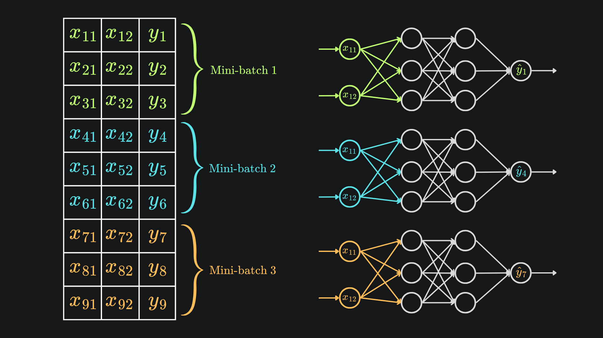

Hasta este punto, mi bucle de entrenamiento procesaba las imágenes una a una. Para cada imagen: forward pass, backprop, actualización de pesos. Repetir 60.000 veces por época. Esto se llama **stochastic gradient descent** (SGD), y aunque funciona, tiene dos problemas serios. Y si no mal recuerdo, lo menciona uno de los vídeos de 3Blue1Brown.

El primero es la velocidad. Numpy es muy rápido cuando le metes operaciones grandes, pero cuando lo llamas 60.000 veces con vectores pequeños, el overhead de Python se come las ventajas. Cada iteración tiene que ir y volver entre el código de Python y el código optimizado de C de numpy, y esa transición no es gratis.

El segundo es la calidad del aprendizaje. Cada actualización de pesos se hace basándose en una sola imagen, lo cual es muy ruidoso... no sé si entiende lo que quiero decir con ruidoso, espero que sí... pero piensa que la dirección del gradiente para una imagen sola puede ser caprichosa, dependiendo de las particularidades de esa imagen concreta. La red oscila bastante en lugar de avanzar con decisión.

## La idea de mini-batches

En lugar de actualizar los pesos imagen por imagen, agrupamos las imágenes en grupos pequeños (mini-batches) y actualizamos una sola vez por grupo, usando el gradiente medio de las imágenes del grupo. Si el batch es de 32, son 1.875 actualizaciones por época en lugar de 60.000.

Eso resuelve los dos problemas a la vez. La velocidad mejora porque cada operación trabaja sobre matrices más grandes y aprovecha mejor numpy. Y la calidad mejora porque el gradiente medio de 32 imágenes es mucho menos ruidoso que el de una sola, así que la red avanza con más decisión.

Es como tomar decisiones promedio en lugar de decisiones reactivas. Si una imagen rara aparece, su gradiente raro se diluye con el de las otras 31 del batch. La red no se desestabiliza por casos atípicos.



## Lo que tenía que cambiar

El forward pass y backprop que tenía esperaban un vector de 784 elementos (una imagen). Para procesar 32 imágenes a la vez, necesitan aceptar matrices de $(32, 784)$ y devolver matrices de salidas. Eso obliga a refactorizar varias funciones.

Esta parte la viví con bastante ansiedad, porque cuando vi el código adaptado por primera vez, me pareció que estábamos cambiando demasiadas cosas. Las dimensiones se reorganizaban, aparecían transposiciones nuevas, los `np.outer` desaparecían y se reemplazaban con multiplicaciones de matrices. Esa reescritura me hizo sentir mal. Peroo...

...la verdad es que matemáticamente no estábamos cambiando nada. Las fórmulas son las mismas. Lo que cambia es que ahora se aplican a matrices en lugar de a vectores, y numpy hace la magia internamente para procesar las 32 imágenes en paralelo.

Para no perder mi versión original (que sí entendía completamente), creé una rama de git llamada `without-batches` antes de empezar el cambio. Así, si todo se rompía, podía volver. Igualmente tenía la IA, por si acaso, pero bueno.

## Los cambios concretos

**Forward pass.** Antes era $z = Wa + b$ con $a$ vector. Ahora $a$ es una matriz $(32, 784)$. Para que las dimensiones cuadren, transponemos $W$:

```python
def forward(self, activations):
    new_act = activations @ self.weights.T + self.bias
    self.Z = new_act
    self.S = self.activation(new_act)
    return self.S
```

`activations` de $(32, 784)$ por `self.weights.T` de $(784, 256)$ da $(32, 256)$, las pre-activaciones de las 32 imágenes a la vez. El bias se suma a cada fila por broadcasting de numpy.

**Softmax.** El problema antes era que `np.sum(exp_arr)` sumaba todos los elementos. Ahora queremos que cada fila se normalice por su propia suma. La solución es `axis=-1` (suma sobre la última dimensión, que son las clases) y `keepdims=True` (mantiene la forma para que la división funcione):

```python
def softmax(arr):
    exp_arr = np.exp(arr)
    exp_sum = np.sum(exp_arr, axis=-1, keepdims=True)
    return exp_arr / exp_sum
```

Detalle bonito: usar `axis=-1` en lugar de `axis=1` hace que la función funcione tanto con un vector solo (eje 0) como con un batch (eje 1). Con `axis=-1` siempre te refieres al "último eje" sin tener que pensar. Eso está guay en Python.

**Cross-entropy.** Antes recibía una predicción y un índice. Ahora recibe predicciones $(32, 10)$ e índices $(32,)$:

```python
def cross_entropy(predictions, correct_indices):
    n = len(correct_indices)
    return -np.mean(np.log(predictions[np.arange(n), correct_indices] + 1e-9))
```

El buen truco es `predictions[np.arange(n), correct_indices]`, que es una especie de indexación avanzada de numpy. Le das dos arrays (uno de filas y otro de columnas) y te devuelve los elementos en esos pares. Así sacas la probabilidad asignada al dígito correcto de cada imagen del batch en una sola operación.

Y el `+ 1e-9` previene que aparezca un $\log(0) = -\infty$ si alguna predicción cae a cero.

**Backpropagation.** El cambio gordo. Para una imagen, el gradiente de los pesos era $dW_2 = dZ_2 \otimes S_1$ con producto exterior. Para 32 imágenes, esa operación se reemplaza por una multiplicación de matrices:

```python
dW2 = dZ2.T @ S1 / batch_size
```

`dZ2.T` es $(10, 32)$, `S1` es $(32, 256)$, el resultado es $(10, 256)$, exactamente las dimensiones de $W_2$. Esa multiplicación de matrices automáticamente suma los productos exteriores de las 32 imágenes (la magia del álgebra lineal), y dividimos entre 32 para sacar la media.

Para los biases es más simple, mira:

```python
db2 = np.mean(dZ2, axis=0)
```

Promedia las 32 filas de $dZ_2$ y devuelve un vector $(10,)$, exactamente el tamaño del bias.

El buen cambio es en `dS1`. Antes era $W_2^T \cdot dZ_2$. Ahora, como $dZ_2$ ya tiene 32 filas, podemos multiplicar directamente sin transponer:

```python
dS1 = dZ2 @ self.layers[-1].weights
```

`dZ2` de $(32, 10)$ por `weights` de $(10, 256)$ da $(32, 256)$. Sin transposiciones extra.

## El bucle de entrenamiento adaptado

El bucle también cambia. Hay que coger batches de 32 imágenes en lugar de iterar una a una. También aproveché para añadir shuffle (barajar el orden de las imágenes) cada época, que es buena práctica:

```python
for epoch in range(epochs):
    indexes = np.random.permutation(60000)

    for start in range(0, 60000, batch_size):
        batch_indexes = indexes[start:start + batch_size]
        X = x_train[batch_indexes]
        Y = y_train[batch_indexes]
        
        # augmentation por imagen (no se puede vectorizar fácilmente)
        augmented = np.empty_like(X)
        for j in range(batch_size):
            angle = np.random.uniform(-15, 15)
            dx = np.random.randint(-3, 4)
            dy = np.random.randint(-3, 4)
            img = rotate(X[j], angle, reshape=False)
            img = shift(img, [dy, dx])
            augmented[j] = img

        X_flat = augmented.reshape(batch_size, 784)
        predictions = network.forward(X_flat)
        network.backprop(X_flat, predictions, Y, learning_rate)
```

## Subir el learning rate

Una cosa que descubrí entrenando. Con mini-batches, el learning rate antiguo de 0.01 se quedaba corto. La red avanzaba muy lento. La razón es que ahora hay 30 veces menos actualizaciones por época, así que cada una tiene que ser más fuerte para compensar. Subiendo el learning rate a 0.1 la convergencia volvió a ser rápida.

Ojo: los hiperparámetros están relacionados entre sí. Cuando cambias uno, los demás puede que necesiten ajustarse. El learning rate y el batch size están especialmente entrelazados, cosa que está bien.

## El resultado

Tras refactorizar todo con mini-batches y subir el learning rate a 0.1, el entrenamiento de 20 épocas tardó menos que antes 10 épocas con SGD puro. Y la precisión final fue de **97.15%** sobre el conjunto de test, comparable a la versión sin mini-batches pero con mucho menos tiempo de entrenamiento.

Más importante todavía: el visualizador web empezó a funcionar bastante mejor. La combinación de data augmentation, mini-batches con gradientes más estables, y mejor inicialización de pesos (cambié a He init en este punto, $\sqrt{2/n_{prev}}$ en lugar de $\times 0.01$) hizo que la red fuera mucho más robusta a dibujos a mano.


## Recapitulación

Mini-batches procesa las imágenes en grupos (en este caso de 32) en lugar de una a una. Cada actualización de pesos usa el gradiente medio del batch.

Eso mejora la velocidad (numpy aprovecha mejor matrices grandes) y la calidad del aprendizaje (gradientes menos ruidosos).

El cambio requiere refactorizar forward, softmax, cross-entropy y backprop para aceptar matrices de $(batch\_size, 784)$ en lugar de vectores. Las matemáticas son las mismas, lo que cambia son las dimensiones.

El bucle de entrenamiento también cambia: shuffle al inicio de cada época, iteración de 32 en 32, augmentation imagen por imagen dentro del batch.

Los hiperparámetros están relacionados: con menos actualizaciones por época, el learning rate sube. Pasé de 0.01 a 0.1.

Con esto la red estaba lista. La parte de matemáticas y entrenamiento estaba terminada. El siguiente paso era construir algo enseñable: un visualizador web donde dibujar dígitos y ver predicciones en tiempo real. Eso lo cuento en [[NN-11 El visualizador web]], donde ya entra Flask, HTML, JavaScript.