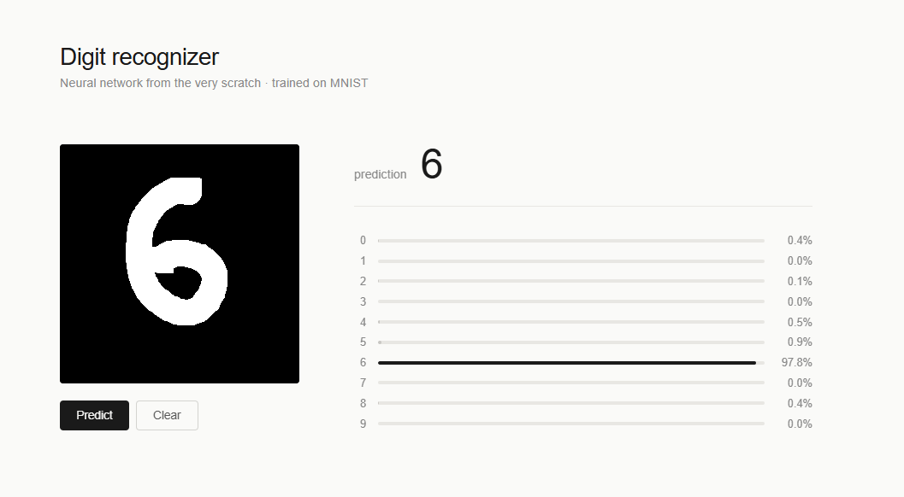

---
---
# Red neuronal desde cero

Este es el mapa de todo. La idea inicial era construir una red neuronal sin frameworks, solo con numpy puro, que reconociera dígitos escritos a mano. Sonaba bien sobre el papel y aparentemente, en mi cabeza, lo era. Ha sido un proyecto duro though.

Aquí está todo explicado con mis palabras. He intentado dejar reflejados los momentos donde me atasqué, las cosas que tardé en ver, las decisiones que tomé sin saber muy bien por qué y luego resultaron tener todo el sentido del mundo. Si algo lo entendí tarde, lo cuento tarde. Si una cosa me pareció una locura cuando funcionó, lo digo. La idea es que esto sirva para mí dentro de un año cuando vuelva a leerlo y para cualquiera que quiera entender no solo qué hace una red neuronal, sino el camino para llegar a entenderla.
## Hilo

[[NN-01 De dónde vino esto]]
[[NN-02 Qué es una red neuronal]]
[[NN-03 Sigmoid y la primera derivada]]
[[NN-04 Softmax]]
[[NN-05 Cross-entropy]]
[[NN-06 La arquitectura — Layer y NeuralNetwork]]
[[NN-07 Backpropagation]]
[[NN-08 Implementación con MNIST]]
[[NN-09 Data augmentation]]
[[NN-10 Mini-batches]]
[[NN-11 El visualizador web]]

## Conceptos sueltos
Cosas que aparecen en muchas notas y que tiene más sentido tener aparte que repetir cada vez:

[[CON-derivada parcial]]
[[CON-regla de la cadena]]
[[CON-producto exterior]]
[[CON-one-hot encoding]]
[[CON-gradient descent]]
[[CON-broadcasting numpy]]

## Resultado final

Completé el proyecto y ahora mismo tengo una red de 784 → 256 → 10, entrenada con MNIST, que sacó alrededor de un 97% de precisión sobre el conjunto de test. Tiene un visualizador web donde puedes dibujar un dígito con el mouse y la red predice en tiempo real. Todo construido con numpy, sin PyTorch y sin TensorFlow. La parte de la web sí que tiene Flask, pero eso no entra en lo que era importante aprender.

